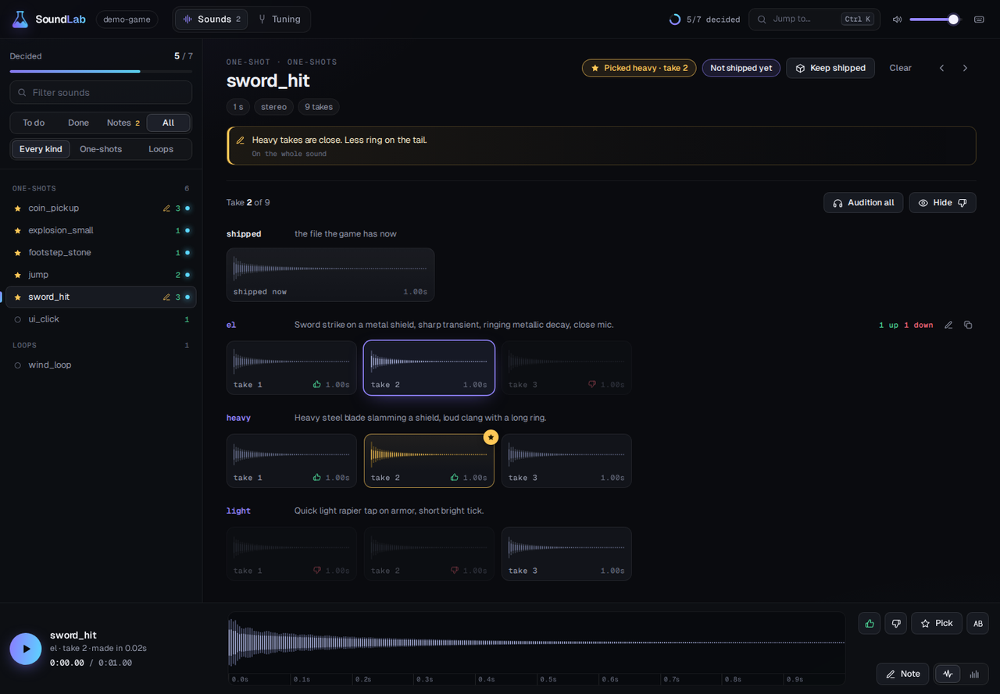
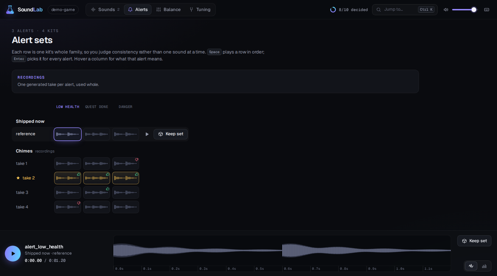
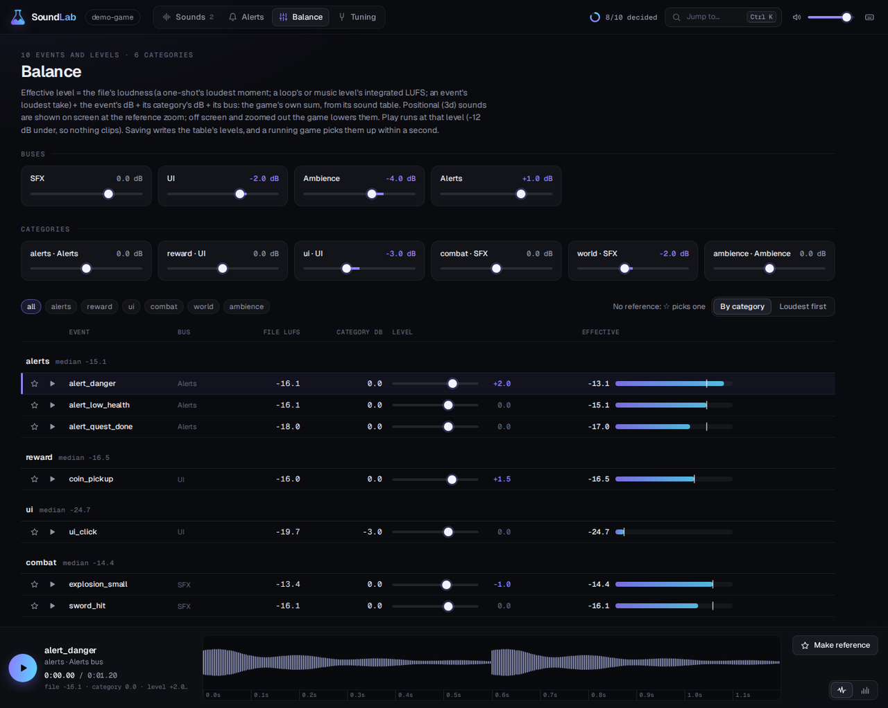
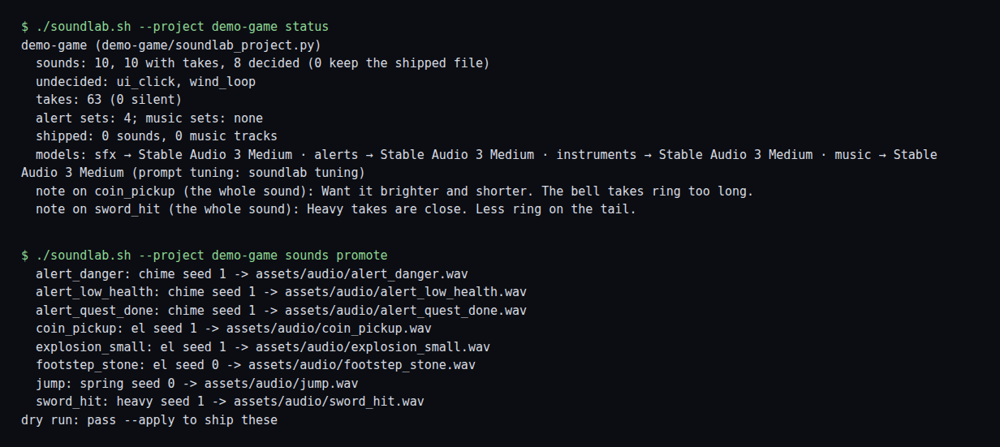

# SoundLab: local AI game audio with Stable Audio 3

**Generate game sound effects and adaptive music on your own NVIDIA GPU with Stable Audio 3, audition and vote on every take in a web app, and ship the winners into your game.** SoundLab runs locally on Windows and Linux (no API, no per-clip fees) and is built to be driven by a coding agent such as Claude Code.



*The Sounds page on a small demo project. The screenshots in this README were captured from a demo game whose takes are synthetic stand-in beeps and noise bursts, made by [`scripts/readme_screenshots.py`](scripts/readme_screenshots.py), because that needs no GPU or model download. Real runs use Stable Audio 3 Medium.*

## Why SoundLab

Text-to-audio models give you a different result for every seed, and picking the good take out of dozens is the slow part of making game audio. SoundLab is built around that part:

- **Many takes, cheaply.** Every sound is generated in several prompt variants and seeds, so you choose from options instead of tuning one prompt.
- **Your ears decide.** You listen and vote in the app. Nothing ships until you pick it.
- **The agent learns from your votes.** Votes feed a per-model prompt-tuning file, so each new round of prompts starts from what already worked.
- **Local and repeatable.** Takes, votes and notes live in plain files, and shipping is a command.

## Features

- **Sound effect generation:** every sound x prompt variant x seed, mastered the way your game masters its files (default -18 LUFS, -1 dBFS limiter), with silent takes flagged and greyed out. See the [speeds](#speeds).
- **Audition and vote in a web app:** thumbs up and down, a starred pick per sound, notes on a sound or on one prompt, A/B against the file your game ships now, and `Ctrl Z` to undo.
- **Waveform and spectrogram player:** hover for time and frequency, click to seek, drag to loop a range.
- **Alert families:** whole alert sets side by side, one kit per row, to judge consistency instead of single sounds.
- **Adaptive music score:** intensity levels that crossfade at any moment and tracks that switch on the bar, all on one beat grid. Includes instrument auditions, derived levels, quality checks and tempo correction.
- **Live mixing:** balance every sound and music level at its in-game loudness against the running game, and save to the game's mix file, which the game reloads live.



*The Alerts page: every kit renders the whole alert set, one kit per row, so you judge the family rather than one sound.*



*The Balance page: each event's effective level is its file's loudness plus the event, category and bus dB, as the game plays it.*

- **Ship it:** `sounds promote` copies the picks into your game with provenance. `ship` and `sync` write a music folder with a manifest and a small engine-agnostic walk (`walk.js`) that plays the score. A [Godot 4 reference player](examples/godot/README.md) is included.
- **Agent-friendly CLI:** one command surface for generating, measuring and shipping, plus [AGENTS.md](AGENTS.md), which tells a coding agent how to drive it.

## Requirements

- An **NVIDIA GPU** with a recent driver. Stable Audio 3 Medium wants about **12 GB of VRAM**.
- **Windows or Linux.**
- Disk space for the model (about 10 GB) plus the Python environment with CUDA PyTorch.
- **ffmpeg** on your PATH, built with the rubberband filter (the music's tempo correction needs it).
- **Node.js 20.19+** with npm, to build the web app at `/app/`.
- Python 3.8+ or [uv](https://docs.astral.sh/uv/) to run the installer. It sets up its own Python 3.12.

## Quick start

```sh
git clone https://github.com/dashw00d/sound-lab.git
cd sound-lab
./install.sh            # Linux
install.cmd             # Windows
./soundlab.sh doctor    # checks the GPU, ffmpeg and the model  (Windows: soundlab.cmd doctor)
```

The installer, `install.py`, does the following, and re-running it only does what's missing:

1. Gets `uv`, the Python manager, if you don't have it.
2. Creates a Python 3.12 environment in `runtime/`.
3. Fetches [Stable Audio 3](https://github.com/Stability-AI/stable-audio-3).
4. Installs CUDA PyTorch, plus a prebuilt flash-attn wheel when one matches your platform (optional; it's faster).
5. Downloads [cocktailpeanut/stable-audio-3-medium](https://huggingface.co/cocktailpeanut/stable-audio-3-medium), an ungated mirror of Stability's model (about 10 GB), and the small analysis models (Audiobox Aesthetics, CLAP, Demucs).
6. Builds the web app (`web-app/`, TypeScript + React) into `soundlab/webapp/` with `npm ci && npm run build`, when Node.js 20.19+ is installed. The build isn't committed, so without Node only the older app at `/` works, not the new one at `/app/`.
7. Ends with a health check that makes one second of audio.

Options:

| option | effect |
|---|---|
| `--hf-home PATH` | keep the model elsewhere, or reuse an existing cache |
| `--cuda cu128` | a different PyTorch CUDA build |
| `--no-model` | skip the download |
| `--no-web` | skip building the web app |

Install Node.js 20.19+ with `winget install OpenJS.NodeJS.LTS` on Windows, or from nodejs.org or your distro's `nodejs` and `npm` on Linux. ffmpeg's full builds for Windows (`winget install Gyan.FFmpeg`) and most Linux packages include the rubberband filter. `./soundlab.sh doctor` checks everything.

**After a `git pull`**, run the installer again: it does only what's missing, and rebuilds the web app when `web-app/` is newer than its build (`doctor` says when it is). Or run `npm run build` in `web-app/` yourself.

### Point it at a game

A project is a game folder with a `soundlab_project.py` that describes its sounds. This minimal one is enough to generate, vote and ship one sound:

```python
from pathlib import Path

from soundlab.project import Project, Sound

HERE = Path(__file__).resolve().parent


def project():
    def sounds():
        return [Sound(name="coin_pickup", kind="oneshot", seconds=1.0, channels=2,
                      prompt="Bright two-note coin pickup chime, metallic ping, retro arcade, dry.",
                      out=HERE / "assets" / "audio" / "coin_pickup.wav")]

    return Project(name="mygame", root=HERE, work=HERE / "work" / "mygame", data=HERE / "soundlab_data",
                   assets=HERE / "assets", sounds=sounds)
```

```sh
./soundlab.sh --project ~/dev/games/mygame sounds generate --seeds 3
./soundlab.sh --project ~/dev/games/mygame serve     # http://127.0.0.1:7870/  (the older app); the newer one is at /app/
```

Vote in the browser, then ship the picks with `sounds promote --apply`. Music, alerts and the Balance page switch on when the project file has `music`, `alerts` and `balance` sections (see AGENTS.md, "The project file"). The newer app at `/app/` is for music projects: on a project without a `music` section it says so and points to the older app.



*`status` and a dry-run `sounds promote` on the demo game. Shipping overwrites your game's files, so it only happens with `--apply`.*

## Usage: pages and commands

The newer app at `/app/` has Library, Families, Mixer, Sessions, Game and Inbox pages. The older app at `/` has the pages below:

| page | what it's for |
|---|---|
| **Sounds** | Every sound's takes in prompt variants × seeds, next to the file the game ships now. 👍 / 👎 / ★ pick, with notes. A/B a take against the shipped file at the same moment. |
| **Alerts** | Whole alert families side by side (one kit per row, each alert a mini waveform), to judge consistency, not single sounds. |
| **Instruments** | Solo auditions of the music's candidate instruments. Picked ones form the pool every track draws from. |
| **Music** | A track's intensity levels playing in sync. Crossfade them live, stack them to hear clashes, switch takes on the bar, and click the timeline to jump to a bar. Liked takes ship as tracks. A profile can mix layers (drum stems made on the same grid) into tension and action; click a layer chip to hear it alone. Each `music generate` run is a batch of takes to listen to, vote on and talk over: the next run hides every one of them, voted on or not, and starts a fresh batch. The page shows only the newest batch; a set's older takes fold under Earlier takes, and older sets under Earlier rounds (liked first). Nothing is deleted, and votes stay with their takes. |
| **Balance** | Every sound and music level at its in-game loudness. Set it, A/B it against a reference, and save to the game's mix file, which the running game reloads live. With a sound table (the game's mix file holds every level: events, categories, buses, music), the page shows exactly the game's own sum and edits the table's levels. |
| **Tuning** | How each model wants its prompts, which model makes what, and your taste, with the evidence from your votes (which prompt styles win, per model). Agents start every prompt from it. |

Across the pages:

- **The dock** at the bottom shows the selected take large, as a waveform or a spectrogram (`V`). Hover for the time (and frequency), click to seek, drag to loop a range, double-click to clear it. Thumbs and pick sit beside it.
- **Jump to anything** with `Ctrl K` (or `/`): any sound, music set, instrument or page.
- **Undo** the last vote or pick with `Ctrl Z`, or from the toast that confirms it.
- **Live**: while a generator runs, the top bar offers the new takes (nothing moves until you click); votes written elsewhere appear on their own.
- **Prompt tuning** (`tuning.json`, shared by every project) holds a guide per model: its rules, the shape of a prompt for each task, good and bad examples. Agents read it with `./soundlab.sh tuning` before writing a prompt and add what your votes teach them. Rules and taste you write (or mark as yours) are instructions they never change; theirs carry their evidence. Assign a different model to a task and it gets its own prompt style.
- Everything is keyboard-driven: `?` lists the keys for the page you're on, `Alt 1–6` switches pages, `M` mutes.

Generating and shipping happen on the command line:

```sh
./soundlab.sh --project P sounds generate --seeds 3          # every sound x prompt variant x 3 seeds
./soundlab.sh --project P sounds promote --apply             # ship the picks into the game
./soundlab.sh --project P alerts build
./soundlab.sh --project P music audition                     # the instrument candidates
./soundlab.sh --project P music generate --contexts day night --biomes any fjords
./soundlab.sh --project P music generate --contexts day --styles story tune --profiles close   # compare prompt styles
./soundlab.sh --project P music derive --profiles drive          # a new profile for the newest batch's takes
./soundlab.sh --project P music promote --apply
./soundlab.sh --project P balance measure
./soundlab.sh --project P tuning --task sfx                 # how to prompt the model that makes sound effects
```

### Speeds

Rough speeds on an RTX 4070 Ti SUPER:

| job | time |
|---|---|
| one sound effect take | under 1 s |
| one music set (a spine plus derived levels, several takes) | 1–3 min |
| a whole game's sound list at 3 seeds | about 20 min |

## How it works

1. **Generate.** `soundlab.engine` loads Stable Audio 3 Medium once and writes takes for every sound, prompt variant and seed. Takes are mastered the way the game masters its files and indexed in `work/<project>/index.json`.
2. **Decide.** The web app (a small standard-library Python server plus a TypeScript and React front end) reads those files on every request. Your votes, picks and notes are written to the project's `data` folder.
3. **Learn.** `tuning.json` holds a guide per model: its prompt rules, good and bad examples, and your taste. Agents read it before writing prompts and add what your votes teach them.
4. **Ship.** `sounds promote` installs the picked takes where the game reads them. Music goes out as a folder the game plays with the walk in `walk.js`.

## Working with a coding agent

SoundLab is made to be driven by a coding agent: the agent writes prompts, generates and ships, and you listen and decide in the app. [AGENTS.md](AGENTS.md) tells it how.

**Point the agent at it.** An agent started in this folder reads AGENTS.md on its own. If you start it in your game's folder, add a line to the game's agent instructions (its AGENTS.md or CLAUDE.md), for example: *"Game audio is made with SoundLab (`path/to/sound-lab`): read its AGENTS.md before working on audio."*

**The loop.** Ask for a round, vote on it in the app, then ask the agent to learn from it:

1. *"The feast takes still aren't working, see my note. Do a new round from the tuning: 4–5 new prompt variants, 6 seeds each."*
2. Listen and vote in the app: thumbs on the near-misses as well as a pick, plus a note on the prompts that miss (`C`, or the pen on a prompt row). A note stays with its prompt, so new prompts start clean.
3. *"I've voted on the feast round. Read the evidence and update the tuning with what it taught you."*

Step 3 is the one people skip, and it's the one that makes the agent better with your models: the votes go into the tuning as rules, so the next round starts from what worked. Thumbs say more than picks alone, because a pick only shows which take won and a thumbs down shows what lost.

Other useful asks:

- *"Add to my taste: I prefer dry, close recordings over big cinematic reverb."* (Or type it on the Tuning page.)
- *"I want to try another model for footsteps. Write it a guide from its documentation and assign it the task."*
- *"Review the tuning: drop agent rules the evidence no longer supports, and tell me which ones my votes contradict."*
- *"Show me what will change if we ship, then ship the picks."* (Shipping overwrites the game's files, so agents only do it when you ask.)

## Joining a project someone else started

Git carries the tool, not a project's work. On a new machine:

- **The game** is its own repo, with its `soundlab_project.py` (Emberhold's is `tools/audio/soundlab_project.py`). Clone it next to this one, or anywhere, and pass `--project` to its folder.
- **The work folder** (`work/<project>`: every take, the index, stems, fills, glues, measurements) is gitignored and stays on the machine that made it. A new machine starts with none: generate takes again, or copy the folder over. The songs already shipped are in the game's repo (its `soundlab/` folder).
- **The data** (votes, picks, cues, notes, prompts, Mixer settings and sessions) lives in the lab's `work/<project>/data`. The first time a project runs, the lab copies it from the game's folder for it (Emberhold's `tools/audio/soundlab`), so a new machine starts from whatever was last shared there. To hand yours on, run `./soundlab.sh --project P data share --apply` (or the Game page's Share button) and commit it in the game. To take someone else's, run `data pull --apply`; your copy is backed up first.

## Layout

```
install.py, install.sh, install.cmd    the installer
soundlab.sh, soundlab.cmd              run the tool with the installed runtime
soundlab/                              the tool: engine, generators, server, the older web app (soundlab/web)
web-app/                               the new web app (TypeScript + React + Vite), built into soundlab/webapp (gitignored)
tuning.json                            prompt tuning: a guide per model, which model makes what, your taste
MODELS_LOG.md                          what we've learned about each model, with the evidence
research/                              experiments outside the app (the music prompt probe) and their raw results
runtime/                               installed (gitignored): Python env, Stable Audio 3, the model cache
```

## License and third-party terms

The model is licensed under the Stability AI Community License (commercial use has conditions: https://stability.ai/license), and T5Gemma under the Gemma Terms of Use. The web app bundles the Geist fonts (SIL Open Font License, `soundlab/web/fonts/OFL.txt`). SoundLab's own code is released under the [MIT License](LICENSE).
